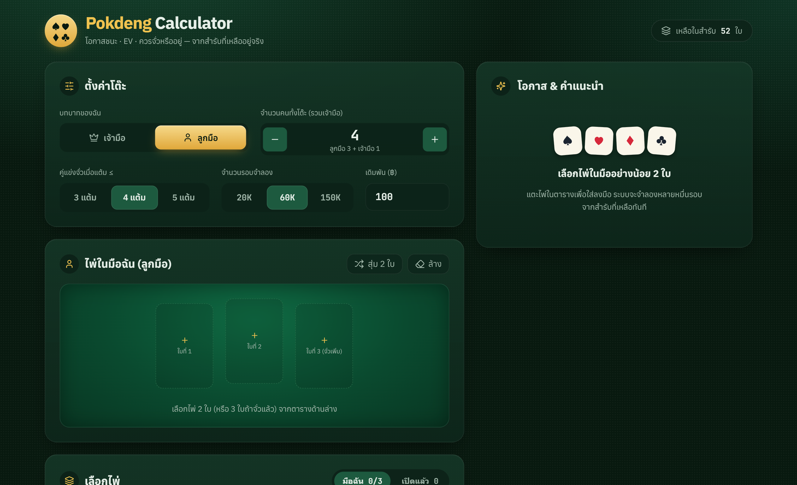
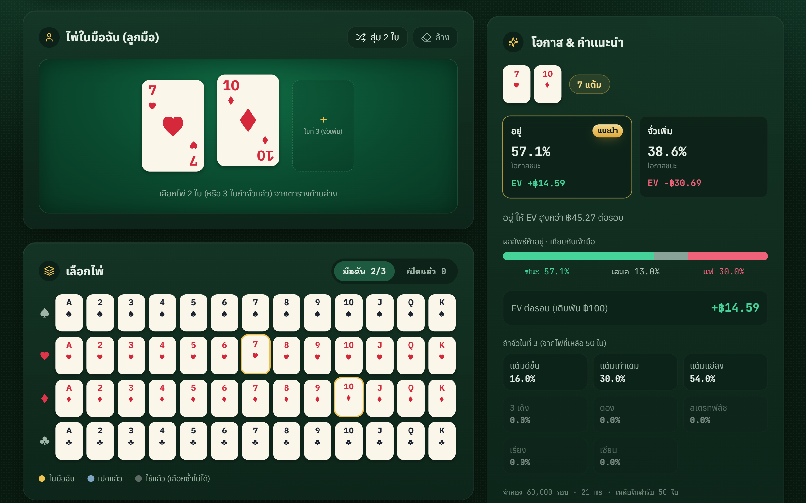
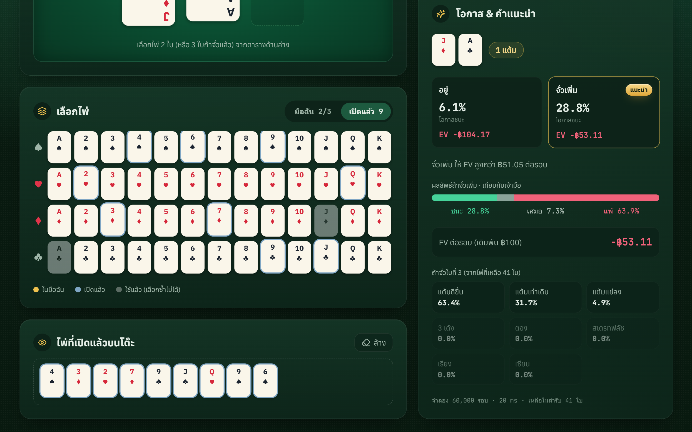

# Pokdeng Calculator

  
  

## ✨ Overview

**Pokdeng Calculator** is a real-time Thai Pok Deng (ป๊อกเด้ง) Probability & Expected Value (EV) Calculator web application built with **Next.js**, **TypeScript**, and **Tailwind CSS**, developed as a project for a **Probability Theory and Statistics** course.

Powered by a client-side **Monte Carlo simulation engine** (supporting up to 150,000 iterations), the app calculates exact win, draw, and loss probabilities from the true remaining deck—accounting for both the player's hand and any revealed cards on the table. 

Configure your role (**เจ้ามือ** Banker or **ลูกมือ** Player), set the table size and bet amount, and pick cards from an interactive 52-card matrix to get instant statistical breakdowns, draw odds (such as **2 เด้ง**, **3 เด้ง**, **ตอง**, **เรียง**, and **เซียน**), and data-driven **อยู่ (Stand)** vs. **จั่วเพิ่ม (Hit)** EV recommendations.

## 🌐 Website

Try the live web application directly in your browser:

https://pokdengcalculator.vercel.app/

## 🖥 Built With

<table>
  <tr align="center">
    <td width="100">
      
    </td>
    <td width="100">
      
    </td>
    <td width="100">
      
    </td>
  </tr>
  <tr align="center">
    <td>Next.js</td>
    <td>TypeScript</td>
    <td>Tailwind CSS</td>
  </tr>
</table>

## 📸 Screenshots

<table>
  <tr>
    <td align="center">
      
       <b>Table Configuration & Dashboard</b>
    </td>
  </tr>
  <tr>
    <td align="center">
      
       <b>Hand Selection & EV Recommendation</b>
    </td>
  </tr>
  <tr>
    <td align="center">
      
       <b>Revealed Cards Tracking & Draw Odds</b>
    </td>
  </tr>
</table>

## ⭐ Support

If you enjoy Pokdeng Calculator, consider giving this repository a ⭐.

It helps more people discover the project and supports future development.